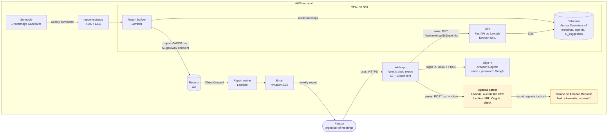

# Spry: containers (C4, level 2)

Updated in Lab 6 with the agenda parser and Amazon Bedrock. Everything runs in
eu-north-1 except Bedrock, which the parser calls in us-east-1. New in Lab 6:
the two yellow boxes.

The two new arrows are the point of Lab 6:

- **parse:** browser → agenda parser → Bedrock. Read-only: text in, JSON out.
  The parser has no route to the database and no permission to write anything.
- **save:** browser → API → Aurora. The same path, validation and
  authentication as every other write. The model's suggestion travels with the
  save and is stored next to the agenda the user confirmed.

The parser sits outside the VPC because it needs no database: it reaches
Bedrock and Cognito's keys over the internet, with no NAT gateway and no VPC
endpoint. See [ADR 0006](adr/0006-llm-agenda-parsing.md).
